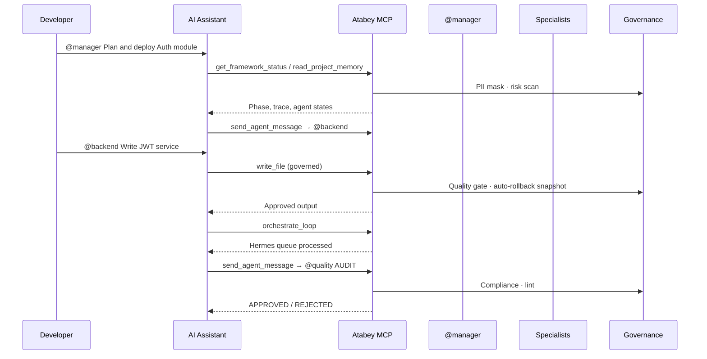

# Atabey — Local AI Control Plane & Discipline Layer

> **Language / Dil:** [English](#atabey--local-ai-control-plane--discipline-layer) · [Türkçe](#turkce)

*v0.1.5 · Lightweight Local Control Plane · 100% strict TypeScript · Cross-platform (macOS, Linux, Windows)*

[](https://www.gnu.org/licenses/agpl-3.0)
[](https://www.npmjs.com/package/atabey)
[](https://modelcontextprotocol.io)

**Atabey** is a **rule-based governance, safety boundaries, and role discipline layer for AI coding assistants** (Local AI Control Plane & Discipline Layer). Running directly on your local machine, it sits between your codebase and your local AI coding tools (Claude Code, Gemini CLI, Cursor, Codex, Local LLMs) to **discipline, bound, and coordinate** them via MCP (Model Context Protocol).

It is not an oversized enterprise SaaS or distributed cloud platform. Its core purpose is simple: **bring order to local AI coding chaos**.

| Layer | Role |
|-------|------|
| **Your AI IDE/CLI** | Writes code, reasons, and executes commands (Claude, Gemini, Cursor) |
| **Atabey Local MCP** | Intercepts operations · enforces boundaries · prevents infinite loops · manages memory |
| **13 Role Profiles** | Dynamic prompt personas (@backend, @architect, @quality, @security...) |
| **`.atabey/` Project Hub** | Local SQLite memory, policy matrix, audit trail, and rollback snapshots |

> [!NOTE]
> **Designed for Local Development:**
> Atabey runs 100% locally on your machine. You don't need cloud infrastructure or heavy orchestration clusters. Just run `npx atabey mcp start` (or connect your AI interface via `.mcp.json`) and let Atabey discipline your AI coding assistants.

> **Philosophy:** "Order from Chaos"
>
> - **What Atabey does:** Keeps your AI coding assistants focused, blocks destructive commands (`rm -rf`, overwriting `.env`), rolls back broken edits, prevents runaway token loops, and tracks project memory.
> - **What Atabey does not do:** It is not a separate LLM runtime or external cloud service. Your AI writes the code; Atabey provides the guardrails and discipline.

---

## 🚀 How It Works

Atabey connects to your AI interface as an **MCP tool server**. Once connected, you use `@agent` commands directly in your AI chat:

```
You (@backend): "Create a user login service with JWT authentication"
     │
     ▼
  Atabey MCP Server (atabey-mcp/)
     │  Intercepts @agent command
     │  Routes via RoutingEngine (TF-IDF + Semantic)
     │  Routes to @backend specialist
     │  Multi-Layer Governance Pipeline validates
     │  Quality Gate checks output
     │  Stores in Vector Memory
     │
     ▼
  Returns governed, reviewed, audited code
```

**No separate terminal needed. No CLI commands for daily use.** Just chat with your AI and use `@agent` syntax.

## 🧠 How Atabey Relates to Your AI

> [!IMPORTANT]
> **Atabey does not write code.** The code is written by the AI assistant you are connected to (such as Claude Code, Gemini CLI, or Cursor).
> Atabey wraps your AI assistant with a powerful, deterministic software engineering discipline and governance layer:
>
> 1. **Routing:** Directs instructions to the correct specialized virtual agent profile (`@backend`, `@security`, etc.).
> 2. **Risk Engine:** Automatically scores operations for safety and halts risky actions (like mass deletions) for human approval.
> 3. **Quality Gate:** Reviews the generated output against corporate standards, syntax correctness, and test metrics.
> 4. **Memory:** Keeps track of past architectural decisions and specialty conventions so your AI assistant learns from history.
>
> *We do not mimic the LLM; we discipline it.*

---

## 📋 Table of Contents

- [Platform Architecture](#platform-architecture)
- [Orchestration Flow](#orchestration-flow)
- [Quick Start](#quick-start)
- [MCP Connection (IDE/CLI)](#mcp-connection-idecli)
- [5 Core Capabilities Overview](#5-core-capabilities-overview)
- [How Atabey Plugs Into Your AI](#how-atabey-plugs-into-your-ai)
- [Supported Platforms](#supported-platforms)
- [Installation](#installation)
- [Profile-Based Setup](#profile-based-setup)
- [13 Specialized Role Profiles](#13-specialized-role-profiles)
- [Multi-Agent Workflow Scenarios & Code Examples](#multi-agent-workflow-scenarios--code-examples)
- [40 MCP Tools](#40-mcp-tools)
- [15 Core Skills](#15-core-skills)
- [3-Layer Memory System](#3-layer-memory-system)
- [Knowledge Base (30+ Standards)](#knowledge-base-30-standards)
- [Multi-Layer Governance Pipeline](#multi-layer-governance-pipeline)
- [Core Features](#core-features)
- [MCP Server & Control Plane](#mcp-server--headless-control-plane)
- [CLI Reference](#cli-reference)
- [Architecture](#architecture)
- [Security](#security)
- [KVKK/GDPR Compliance](#kvkkgdpr-compliance)
- [EU AI Act Alignment](#eu-ai-act-alignment)
- [Token Efficiency](#token-efficiency)
- [Documentation](#documentation)
- [Contributing](#contributing)

---

## Platform Architecture

```
┌─────────────────────────────────────────────────────────────────────────┐
│                         USER / DEVELOPER                                 │
│              @manager planla · @backend API yaz · @quality audit       │
└───────────────────────────────┬─────────────────────────────────────────┘
                                │
        ┌───────────────────────┼───────────────────────┐
        ▼                       ▼                       ▼
┌───────────────┐      ┌───────────────┐      ┌───────────────┐
│ Claude Code   │      │ Gemini CLI    │      │ Cursor IDE    │
│ .claude/      │      │ .gemini/      │      │ .cursor/      │
└───────┬───────┘      └───────┬───────┘      └───────┬───────┘
        │                      │                      │
        └──────────────────────┼──────────────────────┘
                               │ MCP (stdio) — IDE default
                               ▼
┌─────────────────────────────────────────────────────────────────────────┐
│                    ATABEY MCP SERVER (atabey-mcp)                        │
│  Governance Pipeline · Hermes Queue · Orchestrator · Vector Memory       │
│  Risk Engine · Tokens · Auto-Rollback · Human-in-the-Loop               │
└───────────────────────────────┬─────────────────────────────────────────┘
                                │
                                ▼
┌─────────────────────────────────────────────────────────────────────────┐
│  .atabey/  Brain & Memory (SSOT)     │  .agents/  Unified Agent Hub    │
│  ATABEY.md · memory/ · knowledge/     │  8 platform mirrors + skills    │
└─────────────────────────────────────────────────────────────────────────┘
```

**Monorepo layout:**

| Package | Purpose |
|---------|---------|
| `packages/atabey` | CLI, adapters, agent export, init |
| `packages/atabey-mcp` | MCP server, governance middleware, HTTP API |
| `packages/shared` | Shared constants, PII, audit, storage (SSOT) |

---

## Orchestration Flow



**Orchestrator auto-start (default):** When your IDE connects to the MCP server (`mcp.json`), Atabey automatically boots the headless **AgentLoop** orchestrator in the background. No separate terminal is required for daily multi-agent work.

```bash
# Optional — interactive TUI orchestration loop
npx atabey orchestrate

# Optional — unified HTTP/SSE server
MCP_TRANSPORT=unified MCP_PORT=5858 npx atabey-mcp
```

Disable auto-start: set `"orchestrator": { "autoStart": false }` in `.atabey/config.json` or `ATABEY_AUTO_START_ORCHESTRATOR=false` in `mcp.json`.

### Project kinds

| Kind | Where | App code scaffolding |
|------|-------|----------------------|
| **consumer** | Your application repo after `atabey init` | ✅ Governance layer (`.atabey/`) + agents + **real app skeleton under `apps/`** (backend/frontend/mobile/native) matching your stack selection |
| **framework-monorepo** | This GitHub repository (`packages/*`) | ❌ Not applicable — use `packages/atabey`, `packages/atabey-mcp` |

---

## Quick Start

### 1. Initialize Atabey in Your Project

> **Consumer projects:** `atabey init` scaffolds the governance layer (`.atabey/` brain, agent definitions, standards, docs) **and** a real, runnable application skeleton under `apps/` based on your stack selection (`--backend`, `--frontend`, `--focus`, `--native`). You get working project files — `go.mod`/`main.go`, `Cargo.toml`/`main.rs`, `package.json`/`index.ts`, `pom.xml`, `requirements.txt`, React/Next frontends, and a Rust/Go native (FFI) tier — all governed by Atabey from the first commit.
> The **Atabey framework monorepo** itself does not contain `apps/*` — those paths apply only to your own application repositories.

```bash
# Single platform (your app repo)
npx atabey init gemini --profile freelancer --yes

# All 8 platforms (recommended for teams)
npx atabey init gemini --unified --profile team --yes

# Framework monorepo maintainers only (this repository)
npm install          # postinstall runs atabey:setup if .atabey/ is missing
npm run atabey:setup # or run manually
```

### 2. Verify MCP & Platform Health

```bash
npx atabey check     # MCP transport, unified layout, AL registry, compliance
npx atabey status    # Phase, trace, agent states
```

### 3. Connect to Your AI Interface (MCP auto-starts)

`atabey init` generates `mcp.json` with **`MCP_TRANSPORT=stdio`** and **`ATABEY_AUTO_START_ORCHESTRATOR=true`**. Your IDE spawns the MCP server automatically — orchestrator included. Point your AI assistant to it:

**Claude Code:**
```json
{
  "mcpServers": {
    "atabey": {
      "command": "npx",
      "args": ["-y", "atabey-mcp"],
      "env": {
        "MCP_TRANSPORT": "stdio",
        "ATABEY_PROJECT_ROOT": "/path/to/your/project",
        "ATABEY_AUTO_START_ORCHESTRATOR": "true"
      }
    }
  }
}
```

**Gemini CLI:**
```bash
gemini config set mcpServers.atabey.command "npx"
gemini config set mcpServers.atabey.args "[\"-y\", \"atabey-mcp\"]"
gemini config set mcpServers.atabey.env "{\"MCP_TRANSPORT\": \"stdio\", \"ATABEY_PROJECT_ROOT\": \"/path/to/your/project\"}"
```

**Cursor** (`.cursor/mcp.json` — auto-generated by init):

```json
{
  "mcpServers": {
    "atabey": {
      "command": "npx",
      "args": ["-y", "atabey-mcp"],
      "env": {
        "MCP_TRANSPORT": "stdio",
        "ATABEY_PROJECT_ROOT": "/path/to/your/project",
        "ATABEY_AUTO_START_ORCHESTRATOR": "true"
      }
    }
  }
}
```
*(Alternative for offline local installs: `"command": "node"`, `"args": ["node_modules/atabey-mcp/dist/atabey-mcp/src/mcp/index.js"]`)*

> [!IMPORTANT]
> **MCP transport modes**
> - **`stdio`** (default) — Claude, Cursor, Gemini, Codex, Grok. Set by `atabey init` and `atabey mcp install`. In-process stdin/stdout, no network exposure.
> - **`unified`** — HTTP/SSE server on port 5858 for network and remote MCP clients: `MCP_TRANSPORT=unified MCP_PORT=5858 atabey-mcp`
> - **Encryption:** for `unified`/network use, configure TLS 1.3 (+ optional mTLS) via `ATABEY_TLS_CERT_FILE` / `ATABEY_TLS_KEY_FILE` / `ATABEY_MTLS_REQUIRED`. `ATABEY_TLS_REQUIRED=true` refuses plaintext. See [Transport Security](#transport-security-tls-13--mtls).
>
> Repair a broken config: `atabey mcp install`

---

## MCP Connection (IDE/CLI)

| Step | Command | Result |
|------|---------|--------|
| Init | `atabey init gemini --unified --yes` | Agents + 8 adapter MCP configs + shims |
| Repair | `atabey mcp install` | Refreshes root `mcp.json` (stdio + auto-orchestrator) |
| IDE connect | Open Claude / Cursor / Gemini | MCP + orchestrator start automatically |
| Debug | `atabey mcp start` | Manual stdio MCP for troubleshooting |
| Health | `atabey check` | Validates `MCP_TRANSPORT`, unified layout, AL registry |

**Platform orchestration strength:**

| Platform | Orchestration | Best role |
|----------|---------------|-----------|
| Claude Code | Full | Primary orchestrator |
| Gemini CLI | Strong | Commander / strategist |
| Local LLM | Strong | Offline / private |
| Antigravity CLI | Strong | Custom agent JSON |
| Cursor / Grok / Codex | Limited | Implementer / editor |

### 4. Start Using in AI Chat

Open your AI interface and simply type:

```
@backend Create a REST API for user management with CRUD operations
@security Audit the authentication middleware
@quality Run compliance check on the new feature
```

**That's it.** Atabey handles routing, quality gates, memory, governance, and audit automatically.

---

## 5 Core Capabilities Overview

Atabey is built on **5 core capabilities** that work together seamlessly:

| # | Capability | Description |
|---|-----------|-------------|
| 🛠️ | **40 MCP Tools** | File system, search, messaging, governance, memory, quality, network, orchestration |
| 🧠 | **3-Layer Memory** | Vector Memory (TF-IDF/OpenAI), Project Memory, Specialty Memory (agent learning) |
| 🤖 | **13 Specialized Role Profiles** | 3-tier hierarchy (Supreme/Core/Recon) injected dynamically into host LLMs |
| 🎯 | **15 Core Skills** | Platform-adaptive skills for AI coding environments |
| 📚 | **30+ Knowledge Standards** | Governance, security, architecture, compliance, deployment standards |

---

## How Atabey Plugs Into Your AI

```
┌──────────────────────────────────────────────────────────────────┐
│                   YOUR AI INTERFACE                                │
│   Claude Code · Gemini CLI · Cursor · Codex CLI · Local LLM      │
│   You type: @backend Create login service                         │
├──────────────────────────────────────────────────────────────────┤
│                    MCP PROTOCOL (stdio/SSE)                        │
│   JSON-RPC messages over stdin/stdout or HTTP/SSE                 │
├──────────────────────────────────────────────────────────────────┤
│                    ATABEY MCP SERVER                               │
│   ┌──────────────────────────────────────────────────────────┐   │
│   │  40 Tools · Multi-Layer Governance Pipeline ·               │   │
│  │  Risk Engine · Loop Detection · Tokens · Auto-Rollback  │   │
│   └──────────────────────────────────────────────────────────┘   │
├──────────────────────────────────────────────────────────────────┤
│                    GOVERNANCE LAYER                                │
│   Quality Gate → Risk Engine → Vector Memory → Audit Log         │
│   PII Masking → Discipline → License Scan → Injection Protection │
└──────────────────────────────────────────────────────────────────┘
```

Atabey is **not a separate execution engine**. It is a context-aware governance and policy middleware that validates, bounds, and coordinates the tool execution of AI coding assistants:
- **13 Specialized Agent Contexts** (injected templates to structure AI reasoning)
- **Deterministic Quality Gates** (AST analysis + lint + governance validation)
- **Risk Gate & Heuristic Scanning** (blocking dangerous commands, requiring human approval)
- **Persistent Vector Memory** (TF-IDF + OpenAI embeddings, cosine similarity search)
- **Audit trails** (every action logged, supporting KVKK/GDPR technical alignment)

---

## Supported Platforms

Atabey AL supports **8 platforms** with automatic adapter configuration:

| Platform | MCP Transport | Agent Personas | Dynamic Skills | Governance Enforcement | HITL Approval Gate | Audit Chain | Sandbox (env-configured) |
|----------|---------------|----------------|----------------|------------------------|---------------------|-------------|-------------------|
| **Claude Code** ⭐ | Stdio + SSE | Native (`.claude/agents/*.md`) | Full (15 Skills) | **Full** — PreToolUse hook blocks built-in Edit/Write/Bash writes and forces Atabey MCP tools | Webhooks + Passcode | HMAC-SHA256 Chained | none / uid / seatbelt |
| **Gemini CLI** | Stdio + SSE | Native (`.gemini/agents/*.md`) | Full (15 Skills) | **Strong** — governed tools + rules engine (no built-in tool hook API) | Interactive CLI + Web | HMAC-SHA256 Chained | none / uid / seatbelt |
| **Cursor IDE** | Stdio | Rules (`.cursor/rules/*.mdc`) | MDC Ruleset | **Partial** — governed tools via MCP; built-in editor tools rely on rules compliance | Interactive CLI + passcode | HMAC-SHA256 Chained | none / uid / seatbelt |
| **Codex CLI / Copilot** | Stdio | Workspace (`copilot-instructions.md`) | Injected Prompt | **Partial** — governed tools via MCP | CLI Passcode | HMAC-SHA256 Chained | none / uid / seatbelt |
| **Antigravity CLI** | Stdio + SSE | `agent.json` + Subagents | Native Toolset | **Strong** — native tool gating | Real-time WebSocket | HMAC-SHA256 Chained | none / uid / seatbelt |
| **Grok** | Stdio + SSE | Native (`.grok/agents/*.md`) | Context Shims | **Partial** — governed tools via MCP | Interactive CLI + passcode | HMAC-SHA256 Chained | none / uid / seatbelt |
| **Local LLM / Ollama** | Stdio + SSE | Unified Hub (`.atabey/agents/*.md`) | Markdown Specs | **Strong** — all tools route through Atabey | Terminal Gate | HMAC-SHA256 Chained | none / uid / seatbelt |
| **OpenCode** | Stdio | Native (`.opencode/agents/*.md`) | Native Toolset | **Strong** — native permission/agent config | Interactive CLI + passcode | HMAC-SHA256 Chained | none / uid / seatbelt |

> **Governance Enforcement column:** "Full" means built-in host tools are deterministically intercepted (Claude Code `PreToolUse` hooks + `permissions.deny` scaffolded by `atabey init claude`). "Strong" means the platform routes effectively all work through Atabey MCP tools. "Partial" means the host retains native edit/shell tools that Atabey cannot deterministically block — out-of-band edits are still detected post-hoc via SHA-256 hash diffing (`ATABEY_ENFORCE_UNAUDITED_WRITES`) and policy violations are reported. When deterministic blocking is required on a Partial platform, restrict the host's own file-write permissions in its settings.

> **Sandboxing is global and env-driven** (`ATABEY_SANDBOX_RUNTIME=none|uid|seatbelt|auto`), not per-platform. On macOS, `seatbelt` uses `/usr/bin/sandbox-exec`; on Linux, POSIX `uid` drop is used. Set `ATABEY_SANDBOX_REQUIRED=true` to deny execution when isolation is unavailable.

> **Unified Mode:** `atabey init <platform> --unified` configures and mirrors agents across **ALL platforms simultaneously**.

---

## Installation

### Requirements

| Requirement | Version |
|------------|---------|
| **Node.js** | >= 22.0.0 |
| **npm** | >= 9.0.0 |
| **AI Interface** | Claude Code, Gemini CLI, Cursor, Codex CLI, Grok, Antigravity, Local LLM |

### Quick Install

```bash
# Install globally (recommended)
npm install -g atabey

# Initialize with your preferred platform and profile
npx atabey init gemini --profile freelancer --yes

# Verify installation
npx atabey status

# (Optional) Start MCP control plane
npx atabey mcp start
```

### Native Dependency & CI/CD Considerations

Atabey utilizes `better-sqlite3` for local state persistence and high-performance vector operations. Since `better-sqlite3` includes native C++ modules, it requires binary compilation during installation under certain environments.

If you encounter installation or test run issues (especially in restricted sandbox or CI/CD environments with no internet access or build tools):

1. **Prebuilt Binaries:** npm will automatically try to download prebuilt binaries for your platform. Ensure your environment has outgoing network access to the GitHub/npmjs package registries.
2. **Build Tools:** Ensure you have `python`, `make`, and a C++ compiler (like `gcc`/`g++`) installed on your system if you need to build from source.
3. **CI/CD Environments:** For CI/CD test runners, you can bypass native sqlite3 compile-time issues by running with the `--ignore-scripts` flag if you only need the static analysis and typescript compilation checks:
   ```bash
   npm install --ignore-scripts
   ```

---

## Profile-Based Setup

Choose the profile that matches your team size. You can also customize your setup using **`--focus`** and **`--lang`** options.

### `--profile freelancer` (1-3 people)

```bash
npx atabey init gemini --profile freelancer
```

| Feature | What You Get |
|---------|-------------|
| **Agents** | `@manager`, `@backend`, `@frontend`, `@quality`, `@security` (focus-adjusted: backend/frontend/mobile variants keep the security specialist) |
| **Setup Time** | ~10 seconds |
| **Daily Workflow** | Chat with AI using specialist agents |
| **Governance** | Quality gate + risk engine |
| **Best For** | Solo developers, minimal overhead |

### `--profile team` (5-15 people)

```bash
npx atabey init gemini --profile team --unified
```

| Feature | What You Get |
|---------|-------------|
| **Agents** | 8-10 focus-specific agents (manager, architect, analyst, backend, frontend, quality, database, security, devops) |
| **Setup Time** | ~30 seconds |
| **Observability** | Headless control plane (MCP SSE + Hermes WSS Bus), HMAC-signed audit trail, and token accounting & limits |
| **Governance** | Quality gate + risk engine + contract validation |
| **Best For** | Small-medium teams with governance needs |

### `--profile enterprise` (15+ people)

```bash
npx atabey init gemini --profile enterprise
```

| Feature | What You Get |
|---------|-------------|
| **Agents** | All 13 agents (Supreme + Core + Recon) |
| **Setup Time** | ~1 minute |
| **Security** | Human-in-the-Loop, KVKK PII masking, audit log |
| **Governance** | Full governance with circuit breakers |
| **Best For** | Enterprise with compliance requirements |

### Stack-Based Application Scaffolding

`atabey init` generates a **real, runnable** application skeleton under `apps/` that matches your stack selection. Choose the backend, frontend, and native/platform languages and get working project files — all governed by Atabey from the first commit.

```bash
# Go backend + Next.js frontend, Rust native tier (mobile)
npx atabey init gemini --profile team --yes --focus mobile-fullstack --backend go --frontend next --native rust
```

| Selection | Generated under `apps/` | Key files |
|-----------|-------------------------|-----------|
| **Backend `node`** | `apps/backend/` | `package.json`, `tsconfig.json`, `src/index.ts` (Fastify) |
| **Backend `go`** | `apps/backend/` | `go.mod`, `main.go`, `internal/server/` |
| **Backend `python`** | `apps/backend/` | `requirements.txt`, `main.py` (FastAPI) |
| **Backend `dotnet`** | `apps/backend/` | `<name>.csproj`, `Program.cs` |
| **Backend `java`** | `apps/backend/` | `pom.xml`, `src/main/java/.../Application.java` (Spring Boot) |
| **Backend `rust`** | `apps/backend/` | `Cargo.toml`, `src/main.rs` (Axum) |
| **Frontend `vite`** | `apps/web/` | `package.json`, `vite.config.ts`, `src/App.tsx` |
| **Frontend `next`** | `apps/web/` | `package.json`, `next.config.mjs`, `app/` |
| **Frontend `vanilla`** | `apps/web/` | `index.html`, `style.css`, `app.js` |
| **Mobile** | `apps/mobile/` | `package.json`, `App.tsx` (Expo / React Native) |
| **Native `rust`** | `apps/native/` | `Cargo.toml` (cdylib), `src/lib.rs` — FFI tier |
| **Native `go`** | `apps/native/` | `go.mod`, `main.go` — FFI tier |

> **`--focus` gating:** `fullstack` → backend + frontend · `backend` → backend only · `frontend` → frontend only · `mobile` → mobile + native · `mobile-fullstack` → backend + mobile + native.
> The **native/platform tier is Rust or Go only** (TypeScript is forbidden here — see [native-standards](#native--platform-layer-standards)).

---

## 13 Specialized Role Profiles

> [!NOTE]
> **Execution Model:** Atabey's specialized agents are virtual profiles powered by dynamically injected system role definitions and context templates. They do not run as 13 parallel, independent LLM API instances. Instead, your single host AI assistant (e.g., Claude Code, Gemini CLI) takes on these roles sequentially, routed by the TF-IDF engine, while Atabey enforces boundaries, state machine constraints, and quality checks during role switches.

| Role Profile | Tier | Domain | Scope / Responsibility | Freelancer | Team | Enterprise |
|--------------|------|--------|------------------------|:----------:|:----:|:----------:|
| **@manager** | Supreme | Orchestration | Task decomposition, governance, quality gate | ✅ | ✅ | ✅ |
| **@security** | Supreme | Security | Security audit, vulnerability scanning | ✅ | ✅ | ✅ |
| **@architect** | Core | Architecture | System design, contracts, structural integrity | ❌ | ✅ | ✅ |
| **@backend** | Core | Backend | API, server-side logic, data access, tests | ✅ | ✅ | ✅ |
| **@frontend** | Core | Frontend | UI, components, responsive design | ✅ | ✅ | ✅ |
| **@quality** | Core | Quality | Compliance, lint, test coverage, gating | ✅ | ✅ | ✅ |
| **@database** | Core | Database | Schemas, migrations, query optimization | ❌ | ✅ | ✅ |
| **@analyst** | Recon | Analysis | Requirements, domain analysis, strategy | ❌ | ✅ | ✅ |
| **@mobile** | Core | Mobile | React Native and cross-platform apps | ❌ | ❌ | ✅ |
| **@native** | Recon | Native | Native platform integration (Rust/Go only) | ❌ | ❌ | ✅ |
| **@devops** | Core | DevOps | CI/CD, pipelines, infrastructure | ❌ | ✅ | ✅ |
| **@explorer** | Recon | Exploration | Codebase discovery, symbol indexing | ❌ | ❌ | ✅ |
| **@git** | Recon | VCS | Branch hygiene, commits, PR preparation | ❌ | ❌ | ✅ |
| **@human** | — | HITL | Human approval checkpoint | ✅ | ✅ | ✅ |

### Agent Hierarchy
```
User / External Request
    ↓
  @manager (Supreme Authority)
    ↓
  @security (Parallel — always watching)
    ↓
  @architect → @backend / @frontend / @database / @devops
    ↓
  @quality → @mobile / @native / @explorer / @git / @analyst
```

---

## Multi-Agent Workflow Scenarios & Code Examples

Atabey enables structured, governed collaboration across role profiles. Here are 3 primary patterns:

### Scenario 1: Interactive Feature Delivery (Planner → Coder → Verifier)

In your AI chat (Claude Code, Gemini CLI, Cursor), you kick off a brownfield task. The host LLM assumes role profiles sequentially, guided by Atabey's state machine and quality gates:

```bash
# 1. @manager breaks down the requirement and creates an approved DAG plan
You: @manager "We need to add a rate-limiting middleware to our Express API"

# Atabey routes to @manager, validates against architecture standards,
# and emits a structured plan with dependency edges:
# Plan: [T1: @architect (define contract)] → [T2: @backend (implement)] → [T3: @quality (verify)]

# 2. @architect generates types and contract boundaries
You: @architect "Define RateLimitConfig and response contract"
# Calls MCP tool: replace_text (path: "src/contracts/rate-limit.ts")

# 3. @backend implements the middleware within allowed paths
You: @backend "Implement the Redis token-bucket rate limiter"
# Calls MCP tool: write_file (path: "src/middleware/rate-limiter.ts")
# Matrix Enforcement: Allowed for apps/backend/**, denied for apps/web/**

# 4. @quality runs deterministic compliance checks & test suite
You: @quality "Verify TypeScript AST compliance and run test suite"
# Calls MCP tools: analyze_code_quality, run_tests
# Quality Gate: checks test exit code, lint, coverage threshold.
```

### Scenario 2: Autonomous Headless DAG Dispatch with Worktree Isolation

For background execution, Atabey can execute parallel waves across isolated Git worktrees, complete with automatic retries and fallback agents:

```typescript
import { AgentDispatcher } from "atabey";
import type { Plan } from "atabey";

const featurePlan: Plan = {
  planId: "PLAN-RATE-LIMIT-01",
  createdAt: new Date().toISOString(),
  status: "approved",
  approvedBy: "@manager",
  summary: "Parallel API and Frontend integration",
  tasks: [
    {
      id: "T1",
      agent: "@backend",
      task: "Implement rate limiter middleware in apps/backend/src/rate-limit.ts",
      dependencies: [],
      priority: "P1",
    },
    {
      id: "T2",
      agent: "@frontend",
      task: "Add rate-limit warning banner in apps/web/src/components/Banner.tsx",
      dependencies: [],
      priority: "P1",
    },
    {
      id: "T3",
      agent: "@quality",
      task: "Run test suite and verify evidence bundles",
      dependencies: ["T1", "T2"],
      priority: "P2",
    },
  ],
};

// Dispatch executes independent tasks (T1 and T2) in parallel in isolated worktrees:
// - .atabey/worktrees/backend/
// - .atabey/worktrees/frontend/
const report = await AgentDispatcher.dispatch(featurePlan, {
  projectRoot: process.cwd(),
  worktree: true,
  maxConcurrency: 4,
  maxRetries: 1, // Auto-retry transient worker crashes
  fallbackAgent: {
    "@backend": "@manager", // Fallback to supreme tier if worker fails
  },
  perAgentTokenBudget: 50000,
  mergeChanges: true, // Automatically merges clean worktrees back to main tree
  collectEvidence: true,
});

console.log(`Execution status: ${report.ok}`);
console.log(`Waves executed: ${JSON.stringify(report.waves)}`);
console.log(`Collision count: ${report.conflicts.length}`);
console.log(`Signed Evidence Bundles generated: ${report.evidence.length}`);
```

CLI equivalent:
```bash
# Execute plan in parallel with isolated worktrees and quality gates
atabey orchestrate --plan .atabey/plans/current.json --worktree --merge
```

### Scenario 3: Security Triage & Tamper-Evident Evidence Bundle

When handling security fixes or audits:

```bash
# 1. Trigger security analysis
You: @security "Scan all API routes for unauthenticated endpoints"
# Calls MCP tools: inspect_endpoint, get_api_catalog

# 2. Remediate with surgical edit (auto-snapshot created before write)
You: @backend "Patch authentication middleware"
# Calls MCP tool: patch_file (auto-rollback snapshot saved in .atabey/rollbacks/)

# 3. Export cryptographically signed Evidence Bundle
npx atabey audit export --verify
# Outputs HMAC-SHA256 signed audit ledger with tamper-evident proof
```

---

## 40 MCP Tools

### File System (5)
`read_file`, `write_file`, `replace_text`, `batch_surgical_edit`, `patch_file`

### Search & Exploration (6)
`list_dir`, `grep_search`, `get_project_map`, `get_project_gaps`, `get_symbol_outline`, `get_task_context`

### API Catalog (2)
`get_api_catalog`, `inspect_endpoint`

### Framework & System (10)
`run_shell_command`, `run_tests`, `get_system_health`, `check_active_ports`,
`get_framework_status`, `read_project_memory`, `get_memory_insights`,
`update_project_memory`, `orchestrate_loop`, `submit_plan`

### Control Plane (3)
`acquire_lock`, `release_lock`, `register_agent`

### Memory & Knowledge (4)
`store_knowledge`, `search_knowledge`, `delete_knowledge`, `update_contract_hash`

### Messaging & Human (3)
`send_agent_message`, `log_agent_action`, `ask_human`

### Compliance & Quality (4)
`mask_pii`, `analyze_code_quality`, `check_architecture_compliance`, `check_lint`

### Operations (3)
`approve_operation`, `http_proxy_request`, `audit_dependencies`

---

## 15 Core Skills

| Skill | Tools | Description |
|-------|-------|-------------|
| **FILE_SYSTEM** | read_file, write_file | Token-efficient file operations |
| **EDITING** | replace_text, patch_file | Surgical code modification |
| **ORCHESTRATION** | orchestrate_loop, send_agent_message, get_framework_status, log_agent_action | Hermes messaging |
| **GOVERNANCE** | acquire_lock, release_lock, register_agent, update_contract_hash | Resource locking & contracts |
| **QUALITY_ASSURANCE** | run_shell_command, read_file | Testing & code quality |
| **DATABASE_MANAGEMENT** | read_file, replace_text, run_shell_command | DB & migrations |
| **DEVOPS_INFRASTRUCTURE** | run_shell_command, read_file | CI/CD & deployment |
| **SECURITY_AUDIT** | grep_search, read_file, http_proxy_request | Vulnerability assessment |
| **FRONTEND_DEVELOPMENT** | write_file, replace_text, run_shell_command | UI & component design |
| **MOBILE_DEVELOPMENT** | write_file, replace_text | Mobile & cross-platform |
| **GIT_WORKFLOW** | run_shell_command, git | Version control discipline |
| **SOCRATIC_ANALYSIS** | read_file, grep_search, ask_human | Assumption stress-testing & pre-mortem analysis |
| **SPECIFICATION_DESIGN** | read_file, write_file, patch_file | Formal specification & contract engineering |
| **DUAL_AXIS_REVIEW** | read_file, grep_search, run_shell_command | Code quality & specification-fidelity review |
| **SCIENTIFIC_DIAGNOSTICS** | read_file, replace_text, patch_file, run_shell_command | Hypothesis-driven bug diagnostics |

Each skill adapts to the target platform (Claude → native tool names, Gemini → YAML, Codex → categories).

---

## 3-Layer Memory System

| Layer | Storage | Technology | Purpose |
|-------|---------|------------|---------|
| **Vector Memory** | SQLite | TF-IDF / OpenAI embeddings + Cosine similarity | Semantic search across project knowledge |
| **Project Memory** | Markdown | `PROJECT_MEMORY.md` | Central project state, synchronized every session |
| **Specialty Memory** | Markdown | `.atabey/memory/specialties/{agent}.md` | Per-agent learned conventions from past tasks |

**Memory Flow:**
```
Task → Evaluation Engine → Score (0-100)
  ├── Success → extractSuccessLesson() → updateSpecialtyMemory()
  └── Failure → compliance/lint/test lesson → updateSpecialtyMemory()
       ↓
  Next session: readLearnedConventions() → injected into agent prompt
```

---

## Knowledge Base (30+ Standards)

| Category | Standards |
|----------|-----------|
| **Governance** | governance-standards, llm-governance, crud-governance, token-economy |
| **Architecture & API** | architecture-standards, auth-standards, swagger-standards |
| **Development** | frontend-standards, nextjs-standards, vite-standards, kysely-standards |
| **Mobile & Native** | mobile-standards, android-standards, ios-standards, mobile-notifications-standards, native-standards |
| **Security** | security-standards, security-audit-standards, logging-and-secrets |
| **DevOps** | deployment-standards, github-actions-standards |
| **Quality** | quality-standards, testing-standards, vitest-standards, playwright-standards, eslint-standards |
| **Performance & Observability** | performance-standards, observability-standards, pino-standards |
| **UI/UX** | tailwind-standards, react-query-standards, react-router-standards, i18n-standards |
| **Data** | typeorm-standards |
| **Reporting** | reporting-standards, enterprise-systems-standards |

Agent knowledge files are automatically embedded into system prompts at build time.

---

## Multi-Layer Governance Pipeline

Every MCP tool call passes through this pipeline:

```
CallToolRequest
    ↓
 1. [VALIDATION]       Zod schema validation
 2. [PII MASKING]      maskToolArgs() — masked copy for audit/telemetry/logging only
                       (raw args reach the handler, so file content is never corrupted)
 3. [AGENT ROUTING]    Active agent resolution + silent routing
 4. [BYPASS GUARD]     scanUnauditedWorkspaceEdits() — detects host-native tool edits
 5. [POLICY GATE]      denyIfMutatingBlocked() — fail-closed
 6. [RBAC]             enforceToolPermissionMatrix() — deny-by-default path permissions
 7. [INJECTION SCAN]   PromptInjectionProtection on inputs & written content
 8. [TOKENS]           cl100k_base BPE token counting
 9. [GOVERNANCE]       validateArgsAgainstRules()
 10. [DISCIPLINE]      enforceDiscipline()
 11. [TOKEN BUDGET]    Pre-call rate/context gates
 12. [CRUD GOVERNANCE] GovernanceEngine.evaluate() — high-risk op authorization
 13. [LOOP DETECTION]  recordAndCheck() + cooldown
 14. [AUTO-ROLLBACK]   prepareWrite() snapshot
 15. [HUMAN-IN-LOOP]   RiskEngine.assessTaskRisk() + checkRiskGate()
 16. [EXECUTION]       Tool handler runs
 17. [POST-VALIDATION] scanFileForViolations() → rollback if needed
 18. [INJECTION PROTECTION] sanitizeResponse()
 19. [PII MASKING]     maskToolResult() → mask before returning to AI
    ↓
  Return governed result
```

---

## Core Features

### Deterministic Quality Gate
No agent can push code directly to production. All outputs pass through AST analysis (compliance) + linting + governance validation.

### Smart Routing Engine
TF-IDF + Semantic (cosine similarity) routing with 60/40 blend. Falls back to keyword-based routing when embeddings are unavailable.

### Hermes Message Broker
SQLite-backed async message queue for inter-agent communication. Lock-based protocol prevents race conditions.

### Risk Engine (Human-in-the-Loop)
Operations containing `DROP`, `DELETE`, `TRUNCATE`, or secret manipulation are flagged. Score ≥ 60 requires human approval.

### Specialty Memory (Agent Learning)
Agents learn from both successes and failures. Lessons stored in `.atabey/memory/specialties/` and auto-injected next session.

### Auto-Rollback
Pre-write snapshots, post-write governance scan, automatic rollback + regenerate instructions for the AI.

### Token Economy & Cost Tracking
Per-call token accounting via the MCP governance middleware, plus per-provider token/rate ceilings. See [Token Efficiency](#token-efficiency).

### Prompt Injection Protection
OWASP LLM01 aligned heuristic sanitization detected via role-playing, system prompt override, delimiters, and context manipulation patterns.

### Multi-Client MCP (Stdio + HTTP/SSE)
Two transport modes: Stdio (per-developer) and HTTP/SSE (shared server for entire team, port 5858).

---

## MCP Server & Headless Control Plane

```bash
npx atabey mcp start  # Starts headless MCP control plane
```

| Service | Protocol / Transport | Purpose |
|---------|---------------------|---------|
| 🤖 **MCP Stdio** | Stdio (JSON-RPC) | Direct binding to local AI host (Claude Code, Gemini CLI, Cursor) |
| 🌐 **MCP SSE** | HTTP/SSE (`/mcp/sse`) | Network transport for containerized or remote agents |
| 🛡️ **Governance Gate** | Pre-Tool Interceptor | Permission matrix enforcement, PII scanning, prompt injection defense |
| 🧠 **Memory Store** | SQLite (`atabey.db`) | Cross-session context, task tracking, vector storage |
| 🔐 **Audit Chain** | HMAC-SHA256 | Tamper-evident execution trail of all agent actions |

---

## CLI Reference

```bash
atabey init [adapter]           Initialize Atabey (--profile freelancer|team|enterprise)
atabey mcp start|install        MCP server management
atabey orchestrate              Start orchestration loop
atabey check                    System health check
atabey status                   Show agent statuses and costs
atabey plan [submit <json>|list]    Task planning + backlog view
atabey grill <topic>                Socratic assumption stress-testing & pre-mortem analysis
atabey spec init|parse <file>       Specification engine & contract design (docs/specs/)
atabey to-tickets <spec-file>       Decompose specification into DAG tickets
atabey handoff [summary]            Preserve and freeze active session state
atabey retro [title]                Post-task retrospective & permanent memory sync
atabey approve <traceId>        Approve blocked high-risk task
atabey hitl status|answer|approve|reject          HITL responses & approvals
atabey trace new|replay <id>    Execution traces
atabey memory update <sect> <c> Update project memory
atabey git commit|sync|pr|ci-status  Git operations: commit hints, sync, PR creation, CI feedback to agents
atabey explorer graph|audit     Code analysis
atabey security <path>          Security audit
atabey compliance <path>        Run compliance check
atabey contract verify|update   Contract integrity (update re-syncs hash)
atabey lint                     Run ESLint
atabey knowledge <query>        Knowledge base search
atabey log <agent> <msg>        View agent logs
atabey script <name> [dir]      Run predefined script
atabey index [dir]              Index codebase for RAG
atabey db <status|migrate|verify|backup|restore|compact>   SQLite schema, integrity, backups & compaction
atabey secrets <list|set|get|delete|scan>          AES-256-GCM secret vault & leak scan
atabey api <scan|list|drift|json>                  API endpoint catalog & contract drift
atabey audit export|erase                          Signed audit export / KVKK-GDPR erasure
atabey worktree <create|list|remove> [name]        Isolated agent worktrees
atabey coverage                 Test coverage reports
atabey quickstart               Generate example task file
```

### `atabey init [adapter]` Options

| Option | Values | Description |
|--------|--------|-------------|
| `[adapter]` | `gemini`, `claude`, `cursor`, `grok`, `codex`, `local`, `antigravity-cli`, `opencode` | Target AI platform |
| `--profile` | `freelancer`, `team`, `enterprise` | Preset agent group layout |
| `--focus` | `fullstack`, `backend`, `frontend`, `mobile`, `mobile-fullstack` | Project type optimization |
| `--backend` | `node`, `go`, `java`, `python`, `dotnet`, `rust` | Backend application-tier language (aliases accepted, e.g. `golang`, `fastapi`) |
| `--frontend` | `vite`, `next`, `vanilla` | Frontend framework (aliases: `react`, `nextjs`, `html`) |
| `--native` | `rust`, `go` | Native/platform-tier language (TypeScript is forbidden for this tier) |
| `--lang` | `tr`, `en` | Deprecated no-op (kept for backward compatibility) — all generated content is English-only |
| `--unified` | Flag | Multi-platform export |
| `--global` | Flag | Also register MCP in user-level configs (`~/.claude.json`, `~/.gemini/antigravity-cli/`). Off by default — project files only. |
| `--yes` | Flag | Non-interactive mode |

> **Language selection:** In interactive mode you are prompted for backend, frontend, and native languages. With `--yes`, pass them explicitly, e.g.:
> ```bash
> atabey init gemini --profile team --yes --backend go --frontend next --native rust
> ```
> The native/platform tier must be **Rust or Go**. Selections are stored in `.atabey/config.json` and drive the `run_tests` / lint commands the agents use.

---

## Architecture

```
┌──────────────────────────────────────────────────────────────────┐
│                      AI Chat Interface                            │
│    @backend Create login service (in Claude/Gemini/Cursor)      │
├──────────────────────────────────────────────────────────────────┤
│                    MCP Server (atabey-mcp/)                       │
│                    40 Tools · Multi-Layer Governance                │
│                    Zod Validation · PII Masking                  │
├──────────────────────────────────────────────────────────────────┤
│                    src/cli/  30+ Commands                         │
│                    src/modules/  Engines + Agents + Memory       │
│                    src/shared/  Types + Storage + Audit          │
├────────────────┬───────────────────────────┬──────────────────────┤
│                ▼                           ▼                      │
│  ┌──────────────────────────┐  ┌──────────────────────────────┐  │
│  │ MCP SSE Server           │  │ SQLite (better-sqlite3)      │  │
│  │ Port 5858 · /mcp/sse     │  │ Vector Memory · Hermes Queue │  │
│  │ Hermes WSS Bus (/bus)    │  │ Audit Logs · Locks · Tasks  │  │
│  │ mTLS-ready transport     │  │ Knowledge · Agent Registry  │  │
│  └──────────────────────────┘  └──────────────────────────────┘  │
└──────────────────────────────────────────────────────────────────┘
```

---

## Security

### Deterministic & Rule-Based Governance
Deterministic rules: AST compliance parsing, strict TypeScript type validation (zero `any`), and automated governance checks.

### Zero Type Hole Policy
- `any` type usage is **strictly forbidden**
- All function inputs validated with Zod schemas
- Type safety enforced in governance pipeline

### Transport Security (TLS 1.3 + mTLS)
Every network-facing channel — the unified MCP server (HTTP/SSE) and the WebSocket live feed — is served through one HTTP(S) factory, so encryption is applied uniformly:
- **TLS 1.3 by default** (`ATABEY_TLS_MIN_VERSION=TLSv1.3`), with modern cipher defaults.
- **mTLS**: set `ATABEY_MTLS_REQUIRED=true` + `ATABEY_TLS_CA_FILE` to require and verify client certificates.
- **Fail-closed policy**: `ATABEY_TLS_REQUIRED=true` refuses to start without TLS; binding plaintext to a non-loopback host is rejected unless `ATABEY_ALLOW_INSECURE_BIND=true`.
- WebSocket upgrades carry an auth token (`?token=`) or client cert when auth/mTLS is on.

```bash
export ATABEY_TLS_CERT_FILE=/etc/atabey/tls/server.crt
export ATABEY_TLS_KEY_FILE=/etc/atabey/tls/server.key
export ATABEY_TLS_CA_FILE=/etc/atabey/tls/client-ca.crt
export ATABEY_MTLS_REQUIRED=true
export MCP_TRANSPORT=unified
```

### Secret Management
- AES-256-GCM local vault (`atabey secrets`) with per-secret HKDF-SHA256 salts and key rotation.
- Sensitive env vars are scrubbed from spawned subprocesses; leaked credentials in tool output raise a `SECRET_LEAK_DETECTED` audit event.

### SQLite Reliability
- Versioned, checksummed schema migrations; startup `PRAGMA quick_check`/`integrity_check`.
- Atomic online backup/restore with SHA-256 manifests (`atabey db backup|restore|verify`).

### PII Masking (KVKK/GDPR Technical Alignment)
- All logs scanned for Personally Identifiable Information
- Sensitive data automatically masked (20+ patterns)
- Designed to assist with Turkish KVKK (Law No. 6698) and EU GDPR controls
- **Right to Erasure** (KVKK Art. 7 / GDPR Art. 17) technical support

### Human-in-the-Loop
- Risk score ≥ 60 requires human approval
- In-chat approval: `approve_operation` MCP tool
- Terminal fallback: `atabey approve <traceId>`

### AI Discipline Engine
- Rate Limiting: Max 60 calls/minute per agent
- File Size Limits: Prevents >1MB files
- Loop Detection: Blocks >10 consecutive same-tool calls
- Cooldown Mechanism: Automatic when limits exceeded
- Injection Protection: Aligned with OWASP LLM01 guidelines

---

## KVKK/GDPR Technical Alignment

> **Scope:** Technical compliance tooling — not legal certification. Pair with your DPO/legal counsel for production deployments.

| Feature | KVKK | GDPR | Status |
|---------|------|------|--------|
| PII Masking (20+ patterns, checksum-validated TCKN) | Art. 4, 5, 12 | Art. 5, 32 | ✅ Implemented |
| Data Retention (30–730 days, by category) | Art. 5, 7 | Art. 5, 17 | ✅ Auto-cleanup on MCP boot |
| Right to Erasure | Art. 7 | Art. 17 | ✅ `atabey audit erase` (trace / full) |
| Audit Trail (tamper-evident log chain) | Art. 12 | Art. 30 | ✅ SQLite audit log |
| Data Classification | Art. 6 | Art. 9 | ✅ Category-based retention |
| Consent Logging | Art. 5 | Art. 7 | ✅ `.atabey/compliance/consent-log.json` |

Configure in `.atabey/config.json`:

```json
{
  "compliance": {
    "retentionEnabled": true,
    "consentLogging": true,
    "piiMasking": true,
    "dataProcessingBasis": "consent"
  }
}
```

Consent & retention records: `.atabey/compliance/` · CLI: `atabey check`

---

## EU AI Act Alignment

Atabey provides **process and governance alignment** with the EU AI Act via `.atabey/knowledge/llm-governance.md` (scaffolded on `atabey init`):

| EU AI Act principle | Atabey implementation |
|---------------------|----------------------|
| Human oversight | Human-in-the-Loop, risk score ≥ 60 → approval |
| Internal Operation Risk Tiering | Sensitive codebase operations (auth, billing, schema drops) gated by `@manager` & HITL |
| Transparency | AI-generated output labeling rules in llm-governance |
| Data protection | PII masking, retention, erasure (KVKK/GDPR layer) |
| Robustness & safety | Loop detection, injection protection (OWASP LLM01), auto-rollback |

> **Not included:** CE marking, conformity assessment, DPIA templates, or legal EU AI Act certification. Use Atabey as a **technical control layer** alongside legal review.

---

## Token Efficiency

Atabey keeps token consumption low at three layers — **there is no monetary budget layer**:

1. **Measurement** — every MCP tool call is counted with the real `cl100k_base` BPE tokenizer (input/output split) and recorded locally.
2. **Limits** — per-provider context/response/per-minute/per-hour and tool-call rate ceilings (`context-optimizer.ts`). A breach sets a cooldown; hard-blocking is opt-in via `ATABEY_TOKEN_BUDGET_ENFORCE=true`.
3. **Savings** — `read_file` responses are smart-truncated (imports/types/signatures preserved), `http_proxy` caches + strips HTML, loop detection stops token-burning loops, and `get_task_context` / `get_symbol_outline` / `get_api_catalog` feed the AI pre-indexed context instead of forcing full-repo scans.

Tune the per-provider limits with `MCP_MAX_TOKENS_PER_MINUTE`, `MCP_MAX_TOKENS_PER_HOUR`, `MCP_MAX_CONTEXT_TOKENS`, `MCP_MAX_FILE_READ_SIZE`, etc.

Inspect usage: `atabey status`

---

## Testing

```bash
npm test                    # Run all tests
npm run test:watch          # Watch mode
npm run test:coverage       # Coverage report
```

## Benchmarking

Measure Atabey's real-world value (governed vs. baseline AI coding) with the reproducible protocol in [docs/benchmark-protocol.md](docs/benchmark-protocol.md):

```bash
npm run benchmark -- --list # List scenarios (BM-1..BM-5)
npm run benchmark -- --scenario BM-1 --runs 3 --runner "npx atabey" --prompt-file docs/benchmark/prompts/bm-1.md
npm run benchmark -- --scenario BM-1 --runs 3 --runner "npx atabey" --prompt-file docs/benchmark/prompts/bm-1.md --baseline  # without Atabey
```

Scenario prompts live in `docs/benchmark/prompts/`; results are appended to `docs/benchmark-results.json`.

---

## Documentation

- [Known Limitations & System Boundaries](docs/limitations.md)
- [Threat Model (STRIDE)](docs/threat-model.md)
- [Project Roadmap](docs/roadmap.md)
- [Benchmark Protocol](docs/benchmark-protocol.md)
- [Tech Stack](docs/tech-stack.md) · [Auth Architecture](docs/auth.md) · [Storage SSOT Plan](docs/storage-ssot-plan.md)

## Contributing

Please read [CONTRIBUTING.md](CONTRIBUTING.md) for details on the code of conduct and pull request process.

```bash
git clone https://github.com/ysf-bkr/atabey.git
cd atabey
npm install
npm run build
```

---

## License & Business Model

**Code:** GNU Affero General Public License v3.0 — [Yusuf BEKAR](mailto:ybekar@msn.com)

> [!IMPORTANT]
> **Output Exception (Permissive Generated Code Exemption):**
> Source code, applications (`apps/`), templates, and software artifacts scaffolded, generated, or modified by Atabey tools in your repositories belong 100% to you and are **completely exempt** from AGPL-3.0 copyleft obligations. You are free to license your own application code under any proprietary or open-source license of your choice.

> [!NOTE]
> **License choice (deliberate):** AGPL-3.0 was chosen intentionally to keep the control plane open and to require network-facing derivatives to share source (Section 13). Be aware that some corporate policies restrict AGPL adoption. A **dual-licensing option** (commercial license alongside AGPL) is under consideration for enterprise embedders — contact the author for commercial licensing discussions.

This program is free software: you can redistribute it and/or modify it under the terms of the GNU Affero General Public License as published by the Free Software Foundation, either version 3 of the License, or (at your option) any later version.

**Network Use Clause (Section 13):** If you modify the Program and make it accessible over a network (e.g., as a SaaS service), you must provide the complete corresponding source code to all users who interact with it remotely.

> [!NOTE]
> **Enterprise & Dual-Licensing Notice:**
> The open-source edition of Atabey is licensed under **AGPL-3.0** to preserve local software privacy and copyleft integrity. For enterprise teams and organizations whose internal compliance policies restrict copyleft licenses, or who require custom proprietary integrations, a **Commercial License (Dual Licensing)** is available. Please reach out to **ybekar@msn.com** for commercial licensing terms.

**Service Model:**
- **Support & SLA** — Guaranteed response times, priority bug fixes, custom integrations
- **Consulting & Training** — Team onboarding, governance policy design, architecture review
- **Managed Team Server** — Centralized telemetry and shared audit chain

Business inquiries: **ybekar@msn.com**

---

*Developer: **Yusuf BEKAR** — "Order from Chaos"*

---

<a id="turkce"></a>
# Türkçe — Atabey

> **Dil notu:** Proje **kodu, şablonları, standartları, CLI metinleri ve ajan tanımları İngilizcedir**. Yalnızca bu kök `README.md` hem İngilizce hem Türkçe sunulur. Paket README dosyaları (`packages/*/README.md`) İngilizcedir.

## Atabey nedir?

**Atabey**, **AI kodlama asistanları için kural tabanlı yönetişim, güvenlik sınırları ve rol disiplini katmanıdır** (Local AI Control Plane & Discipline Layer). Doğrudan kendi yerel geliştirme makinenizde çalışarak Claude Code, Gemini CLI, Cursor, Codex, Grok, Antigravity veya yerel LLM gibi araçlarınızın üzerine MCP (Model Context Protocol) ile bağlanır.

Büyük, hantal ve karmaşık bir bulut SaaS platformu değildir. Temel görevi nettir: **Lokal bilgisayarınızdaki AI kodlama kaosunu disipline etmek ve kontrol altında tutmak.**

| Katman | Rol |
|--------|-----|
| **AI IDE/CLI’niz** | Kod yazar, akıl yürütür, komutları yürütür (Claude, Gemini, Cursor) |
| **Atabey Yerel MCP** | Eylemleri denetler · tehlikeli komutları engeller · döngüleri durdurur · bellek tutar |
| **13 Rol Profili** | İhtiyaca göre devreye giren sistem şablonları (@backend, @architect, @quality, @security...) |
| **`.atabey/` Proje Merkezi** | Yerel SQLite belleği, dosya izin matrisi, denetim izi ve otomatik geri alma yedekleri |

> [!NOTE]
> **Yerel Geliştirme İçin Tasarlandı:**
> Atabey %100 kendi bilgisayarınızda çalışır. Ayrı bir sunucu, bulut altyapısı veya karmaşık orkestrasyon kümesi gerektirmez. Terminalden `npx atabey mcp start` demeniz veya AI aracınıza `.mcp.json` üzerinden bağlamanız yeterlidir.

> **Felsefe:** “Kaostan Nizam” / *Order from Chaos*
>
> - **Atabey ne yapar:** AI asistanlarınızın projenin hassas dosyalarını (`.env`, `.git`) bozmasını engeller, riskli kabuk komutlarında insan onayı ister, hatalı toplu düzenlemeleri otomatik geri alır (auto-rollback), sonsuz döngüleri ve token israfını keser.
> - **Atabey ne değildir:** Bağımsız bir LLM modeli veya bulut servisi değildir. Kodu AI asistanınız yazar; Atabey ise onu dizginleyen yerel başmühendis ve güvenlik kontrol noktasıdır.

> **Atabey’in Sınırları ve Kapsamı:**
> - **Kapsam İçi:** Politika ve yetki matrisi, risk analizi, token kotası, HMAC imzalı denetim izi, görev ve ajan yaşam döngüsü, insan onayı (HITL).
> - **Kapsam Dışı:** Kendi model çağrı katmanı, ML tabanlı tehdit analizi, hukuki uyumluluk sertifikası, çok makineli dağıtık orkestrasyon.
> - **Otonom Ajan:** Atabey’in başlattığı, sınırladığı ve izlediği host CLI sürecidir (Claude Code, Gemini CLI).
> - **Hedef Otonomi:** Sandbox + adım limiti içinde çalışan ve çıktısını izole dalda PR/diff olarak veren seviyedir. Gözetimsiz ve prod erişimli otonomi kapsam dışıdır.
> - **Asla Otonom Olmayacaklar:** Prod deploy, yıkıcı DB işlemleri, secret/anahtar yönetimi, force push veya main’e doğrudan merge, ödeme işlemleri, kendi politika ve izin dosyalarını değiştirme.

---

## Nasıl çalışır?

Atabey, AI arayüzünüze **MCP tool sunucusu** olarak bağlanır. Kök dizindeki ve IDE'deki yönerge şablonları (`CLAUDE.md`, `AGENTS.md`) sayesinde model `@agent` rollerini tanır:

```
Siz (@backend): "JWT kimlik doğrulamalı kullanıcı login servisi yaz"
     │
     ▼
  AI Asistanınız (Claude Code / Gemini CLI / Cursor)
     │  IDE talimatı (CLAUDE.md / AGENTS.md) ile uzman rolünü yükler
     │  İşlemleri Atabey MCP araçlarıyla (write_file, run_shell_command) yürütür
     ▼
  Atabey MCP Middleware (atabey-mcp)
     │  Araç çağrısını yakalar, yetki ve risk matrisini denetler
     │  Zararlı komutları veya izin dışı dosya erişimini engeller
     │  Quality Gate ve AST denetimi (sıfır any, sıfır console.log) uygular
     │  Pre-commit kancalarıyla (.githooks) nihai zorlayıcı teyidi sağlar
     │  Vector Memory & Audit Trail zincirine kaydeder
     ▼
  Yönetilmiş, denetlenmiş, izli kod üretilir
```

Günlük kullanımda ayrı bir terminal gerekmez. AI sohbetinde `@agent` sözdizimi yeterlidir.

**Önemli:** Atabey kod yazmaz. Kodu Claude Code / Gemini / Cursor gibi bağlı asistan yazar. Atabey:

1. **Routing** — doğru uzman profile (`@backend`, `@security`, …)
2. **Risk Engine** — tehlikeli işlemleri skorlar, gerekirse insan onayı ister
3. **Quality Gate** — standartlara, sözdizimine, test metriklerine göre denetler
4. **Memory** — mimari kararlar ve uzmanlık geçmişini tutar

---

## Platform mimarisi

```
Kullanıcı / Geliştirici
  → Claude Code / Gemini CLI / Cursor IDE
  → MCP (stdio)
  → Atabey MCP Server
       Yönetişim · Hermes kuyruk · Orchestrator · Vector Memory
       Risk · Tokens · Auto-Rollback · Human-in-the-Loop
  → .atabey/  (beyin)  ·  .agents/  (birleşik ajan hub)
```

**Monorepo paketleri:**

| Paket | Amaç |
|-------|------|
| `packages/atabey` | CLI, adapter’lar, ajan export, init |
| `packages/atabey-mcp` | MCP sunucu, yönetişim middleware, HTTP API |
| `packages/shared` | Ortak constants, PII, audit, storage (SSOT) |

---

## Hızlı başlangıç

```bash
# Tek platform
npx atabey init gemini --profile freelancer --yes

# 8 platform (ekip için önerilir)
npx atabey init gemini --unified --profile team --yes

# Sağlık kontrolü
npx atabey check
npx atabey status
```

**MCP bağlama (özet — Claude / Cursor):**

```json
{
  "mcpServers": {
    "atabey": {
      "command": "npx",
      "args": ["-y", "atabey-mcp"],
      "env": {
        "MCP_TRANSPORT": "stdio",
        "ATABEY_PROJECT_ROOT": "/path/to/your/project",
        "ATABEY_AUTO_START_ORCHESTRATOR": "true"
      }
    }
  }
}
```

Sohbette:

```
@backend Create a REST API for user management with CRUD operations
@security Audit the authentication middleware
@quality Run compliance check on the new feature
```

> **İçerik dili:** Oluşturulan anayasa, standartlar, ajan talimatları ve CLI metinleri **İngilizcedir**. `--lang` bayrağı içerik dilini değiştirmez (geriye dönük uyumluluk için kabul edilebilir).

---

## 5 temel yetenek

| # | Yetenek | Açıklama |
|---|---------|----------|
| 🛠️ | **40 MCP Tool** | Dosya sistemi, arama, mesajlaşma, yönetişim, bellek, kalite, ağ, orkestrasyon |
| 🧠 | **3 katmanlı bellek** | Vector (TF-IDF/OpenAI), Project Memory, Specialty Memory |
| 🤖 | **13 uzman rol profili** | Supreme / Core / Recon hiyerarşisi |
| 🎯 | **15 core skill** | 8 AI platformuna uyarlanan skill setleri |
| 📚 | **30+ knowledge standard** | Yönetişim, güvenlik, mimari, test, deployment |

---

## Desteklenen platformlar

| Platform | MCP | Not |
|----------|-----|-----|
| Claude Code | `.mcp.json` + Hook | En güçlü orkestrasyon & Hard Governance (PreToolUse Hook) |
| Gemini CLI | `.gemini/mcp.json` | Güçlü komutan / stratejist |
| Cursor | `.cursor/mcp.json` | Implementer / editör |
| Codex / Copilot | `.vscode/mcp.json` | Sınırlı skill seti |
| Antigravity | `.agents/mcp_config.json` | Custom agent JSON |
| Grok | `.grok/mcp_config.json` | Sınırlı skill seti |
| Local LLM | `.atabey/mcp_config.json` | Offline / private |
| OpenCode | `opencode.json` | Stdio MCP |

```bash
npx atabey init claude --unified   # tüm platformlara export
```

---

## Kurulum gereksinimleri

| Gereksinim | Sürüm |
|------------|--------|
| Node.js | >= 22 |
| npm | >= 9 |
| AI arayüzü | Claude, Gemini, Cursor, Codex, Grok, Antigravity veya local LLM |

```bash
npm install -g atabey
npx atabey init gemini --profile freelancer --yes
npx atabey status
npx atabey mcp start   # MCP sunucusunu başlat
```

`better-sqlite3` native bağımlılıktır; CI’da derleme sorunlarında `npm install --ignore-scripts` ve önceden derlenmiş binary’ler gerekebilir.

---

## Profiller

| Profil | Kim için | Ne gelir |
|--------|----------|----------|
| `--profile freelancer` | 1–3 kişi | Az profil, düşük sürtünme |
| `--profile team` | 5–15 kişi | 5–8 odak profili, unified önerilir |
| `--profile enterprise` | 15+ | Tam 13 rol profili, sıkı yönetişim |

Odak: `--focus fullstack|backend|frontend|mobile`

---

## 13 uzman rol profili (özet)

| Ajan | Katman | Rol |
|------|--------|-----|
| `@manager` | Supreme | Orkestrasyon, onay zinciri |
| `@security` | Supreme | Güvenlik denetimi |
| `@architect` | Core | Tasarım, kontratlar |
| `@backend` / `@frontend` | Core | API / UI |
| `@quality` | Core | Uyumluluk, lint, coverage |
| `@database` / `@devops` | Core | Veri / CI-CD |
| `@analyst` / `@mobile` / `@native` | Core | Strateji / mobil / native |
| `@explorer` / `@git` | Recon | Keşif / versiyon kontrol |

---

## Çoklu-Ajan Senaryoları ve Kod Örnekleri

Atabey rol profilleri arasında yönetişimli ve doğrulanabilir işbirliği sağlar:

### Senaryo 1: İnteraktif Geliştirme Döngüsü (Planlayıcı → Kodlayıcı → Doğrulayıcı)

AI arayüzünüzde (Claude Code, Gemini CLI, Cursor) bir geliştirme başlattığınızda roller sıralı olarak devreye girer:

```bash
# 1. @manager gereksinimi alt görevlere (DAG) böler ve onaylar
Siz: @manager "Express API projemize Redis tabanlı rate limiting middleware'i ekle"

# 2. @architect arayüz kontratlarını ve tip tanımlarını yazar
Siz: @architect "RateLimitConfig ve hata yanıt tiplerini contracts altına çıkar"

# 3. @backend implementasyonu izin verilen dizin sınırları içinde tamamlar
Siz: @backend "Token bucket algoritmasıyla middleware servisini yaz"
# İzin Matrisi: apps/backend/** izni açık, apps/web/** yazımı engelli

# 4. @quality testleri çalıştırır ve AST kurallarını doğrular
Siz: @quality "Kod kalitesini ve test coverage durumunu denetle"
```

### Senaryo 2: Bağımsız Paralel DAG Orkestrasyonu ve Worktree İzolasyonu

Arka planda paralel görev koşumu, otomatik yeniden deneme (retry) ve hata durumunda fallback ajan devreye alma:

```typescript
import { AgentDispatcher } from "atabey";
import type { Plan } from "atabey";

const plan: Plan = {
  planId: "PLAN-AUTH-01",
  createdAt: new Date().toISOString(),
  status: "approved",
  approvedBy: "@manager",
  summary: "Auth modülü ve UI entegrasyonu",
  tasks: [
    { id: "T1", agent: "@backend", task: "JWT login servisini yaz", dependencies: [], priority: "P1" },
    { id: "T2", agent: "@frontend", task: "Login form bileşenini ekle", dependencies: [], priority: "P1" },
    { id: "T3", agent: "@quality", task: "Tüm testleri ve uyumluluğu doğrula", dependencies: ["T1", "T2"], priority: "P2" },
  ],
};

// T1 ve T2 izole Git worktree'lerinde paralel çalışır:
const report = await AgentDispatcher.dispatch(plan, {
  projectRoot: process.cwd(),
  worktree: true,           // Her ajana özel .atabey/worktrees/<agent>
  maxConcurrency: 4,
  maxRetries: 1,            // Geçici çökmelerde 1 kez otomatik tekrar
  fallbackAgent: {
    "@backend": "@manager", // Başarısızlıkta üst komutana devret
  },
  perAgentTokenBudget: 50000,
  mergeChanges: true,       // Çakışmasız dalları ana dala otomatik aktar
  collectEvidence: true,    // İmzalı kanıt paketi üret
});
```

CLI üzerinden tek komutla:
```bash
atabey orchestrate --plan .atabey/plans/current.json --worktree --merge
```

### Senaryo 3: Güvenlik Denetimi ve Kriptografik Kanıt Paketi (Evidence Bundle)

```bash
# 1. Güvenlik taraması yap
Siz: @security "Açık endpoint'leri ve yetkilendirme açıklarını tara"

# 2. Cerrahi yama uygula (otomatik geri alma yedeği alınır)
Siz: @backend "Kimlik doğrulama middleware açığını kapat"

# 3. HMAC-SHA256 imzalı denetim zincirini dışa aktar ve doğrula
npx atabey audit export --verify
```

---

## MCP tool grupları

- **Dosya sistemi:** read/write, replace, patch, batch edit
- **Shell:** allow-list’li `run_shell_command` (+ opsiyonel uid/gid sandbox)
- **Arama:** list_dir, grep, project map/gaps
- **Mesajlaşma:** send_message, ask_human, approve, log
- **Bellek / knowledge:** store/search/delete, insights
- **Framework:** status, orchestrate, plan, tests, audit_deps
- **Kalite / compliance / control plane / observability / network**

---

## 3 katmanlı bellek

1. **Vector Memory** — TF-IDF veya OpenAI embedding + cosine
2. **Project Memory** — `PROJECT_MEMORY.md`
3. **Specialty Memory** — ajan bazlı öğrenilmiş dersler

---

## Yönetişim pipeline (özet)

Her tool çağrısında (pre/post): schema validation → PII mask (yalnızca audit/log kopyası; disk yazımı ham argümanla yapılır) → silent routing → bypass guard → policy gate → RBAC → injection taraması → token sayımı → rules → discipline → token bütçesi → CRUD governance → loop detection → auto-rollback snapshot → risk/HITL → **execute** → post-validation → injection sanitize → PII mask (result) → audit / WebSocket.

Yerel, harici bağımlılıksız ek katmanlar:

- **In-memory Job Queue** — eşzamanlı ajan işi sınırı
- **Worker threads pool** — CPU işleri
- **Atomic file lock (`wx`)** — dosya yarışları
- **uid/gid sandbox** — shell izolasyonu (yapılandırıldığında)
- **Circuit breaker + exponential backoff** — geçici hata dayanıklılığı

---

## MCP Sunucusu ve Kontrol Düzlemi

```bash
npx atabey mcp start
# veya
MCP_TRANSPORT=unified MCP_PORT=5858 npx atabey-mcp
```

---

## CLI (seçme)

| Komut | Açıklama |
|-------|---------|
| `atabey init …` | Proje iskeleti + adapter export |
| `atabey check` / `status` | Sağlık / ajan durumu |
| `atabey mcp start\|install` | MCP yönetimi |
| `atabey orchestrate` | Etkileşimli orkestrasyon döngüsü |
| `atabey plan` / `approve` / `trace` | Plan, onay, iz |
| `atabey memory` / `knowledge` | Bellek / bilgi bankası |

---

## Güvenlik ve uyumluluk (dürüst özet)

- Allow-list shell, risk skoru, HITL, PII maskeleme, loop detection
- **Sandbox varsayılan kapalıdır** — `ATABEY_SANDBOX_UID` / `USER` ile açılır
- KVKK / GDPR / EU AI Act: teknik hizalama kontrolleri vardır; yasal “tam uyumluluk” iddiası yoktur
- Detay: [SECURITY.md](./SECURITY.md), [PRIVACY.md](./PRIVACY.md)

---

## Token verimliliği

Her tool çağrısı gerçek `cl100k_base` BPE tokenizer ile ölçülür; sağlayıcı bazlı token/dakika/saat limitleri ve akıllı dosya kırpma ile tasarruf edilir. **Para/bütçe katmanı yoktur** (`ATABEY_TOKEN_BUDGET_ENFORCE=true` ile sert blok opsiyoneldir).

---

## Test ve katkı

```bash
npm test
npm run test:watch
npm run test:coverage
```

Katkı süreci: [CONTRIBUTING.md](./CONTRIBUTING.md)

```bash
git clone https://github.com/ysf-bkr/atabey.git
cd atabey && npm install && npm run build
```

---

## Lisans ve iş modeli

**Kod:** AGPL-3.0 — Yusuf BEKAR

Ağ üzerinden (SaaS) sunulursa kaynak kod paylaşımı gerekir (AGPL §13).

**Hizmet:** kurumsal destek/SLA, danışmanlık/eğitim, yönetilen enterprise sunucu.
İletişim: **ybekar@msn.com**

---

*Geliştirici: **Yusuf BEKAR** — “Order from Chaos”*
